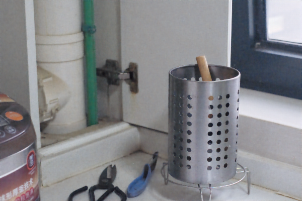
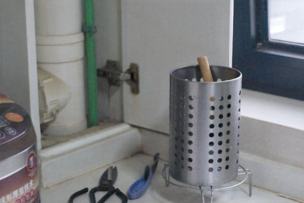

# LowLight-Transformer-Lab

**基于 Transformer 的低光照图像增强：复现、对比与推理优化**。主题：Transformer Models in CV。

仓库：[https://github.com/xiaosen-017/LowLight-Transformer-Lab](https://github.com/xiaosen-017/LowLight-Transformer-Lab) · [全部阶段 Issues](https://github.com/xiaosen-017/LowLight-Transformer-Lab/issues?q=is%3Aissue) · [里程碑](https://github.com/xiaosen-017/LowLight-Transformer-Lab/milestones?state=all) · [建仓验收与平台限制](docs/github_setup.md)。

**M1 PASS (single-image inference on CPU)**。M2 / M3 / M4 / M5：**TODO**。两张真实图已在本机加载作者权重并推理，不代表论文全量指标复现。5.37 秒与 34.00 秒仅为历史运行记录，不能直接用作正式速度基准。

| 论文 / 官方实现 | M1 固定 commit | 方法重点 |
| --- | --- | --- |
| [Retinexformer (ICCV 2023)](https://arxiv.org/abs/2303.06705) · [官方代码](https://github.com/caiyuanhao1998/Retinexformer) | `2dd9ae05f34a34e2df3b955f743215ac3cda0f82` | Retinex 分解思路、光照引导 Transformer |
| [LLFormer (AAAI 2023)](https://arxiv.org/abs/2212.11548) · [官方代码](https://github.com/TaoWangzj/LLFormer) | `ed5e7bf61d2dc64ba3b4552b90eb68a38f6c5302` | 轴向注意力、跨层特征融合、超高清低光照增强 |

## 先看 M1 真实成果

两模型使用同一张 LOL-v1 `111.png`，原尺寸 600×400，输出 RGB；Windows CPU、Python 3.7.9、Torch 1.13.1+cpu、torchvision 0.14.1+cpu，两个环境独立。

| Retinexformer：PASS | LLFormer：PASS |
| --- | --- |
|  |  |

以上是 M1 原始输出，不是新一轮 M2 对比实验。原图不重新分发；[出处与获取方式](data/README.md)。权利归原数据集作者，本仓库及其输出仅用于当前私有组内非商业学术研究，不声明数据图像为 MIT。

- [M1 报告与限制](docs/M1_REPORT.md)、[原始报告脱敏归档](docs/archive/M1_REPORT.original.redacted.md)、[真实成功/失败日志](logs/README.md)。
- [Retinexformer 运行说明](docs/run_retinexformer.md)、[LLFormer 运行说明](docs/run_llformer.md)、[依赖记录](environments/README.md)、[权重获取和哈希](weights/README.md)。

## 快速开始

```powershell
git clone https://github.com/xiaosen-017/LowLight-Transformer-Lab.git
cd LowLight-Transformer-Lab
./scripts/setup_upstreams.ps1
# 分别按两份运行说明准备独立环境和官方权重，然后：
./scripts/run_retinexformer.ps1 -PythonExe ./.venvs/retinexformer/Scripts/python.exe
./scripts/run_llformer.ps1 -PythonExe ./.venvs/llformer/Scripts/python.exe
```

脚本会核对上游 commit、权重 SHA-256/大小，缺少依赖文件时给出错误和说明链接。可以通过 `-Upstream`、`-Weights`、`-InputPath`、`-OutputDir` 显式引用本机已存在的 M1 代码/环境/权重，不会重建或修改那些环境。新运行输出进入被忽略的 `runs/`，不覆盖 `results/m1/` 历史证据。

## 后续研究与分工

- [路线与阶段验收](docs/roadmap.md)：M1 已归档；M2 统一 5–10 图；M3 配对评估和方法分析；M4 分块/融合消融；M5 三页报告与15分钟展示。
- [统一评估协议草案](docs/evaluation_protocol.md)：参数、数据划分、PSNR/SSIM、计时/资源记录在运行前冻结。
- [M4 创新计划](docs/innovation_plan.md)：**仅优化 LLFormer 分块推理和重叠融合，不改网络、不重训**；先小图正确性再逐级扩展，不能预先承诺提升或4K/8K吞吐。
- [三人协作和 PR 规范](CONTRIBUTING.md)：组员 A/B/C 为角色预留，未猜测 GitHub 用户名。拿到实际账号后由仓库所有者邀请再认领 Issue。

## 主要目录

```text
configs/       固定上游与权重清单
docs/          M1档案、运行说明、路线、评估协议、M4计划
scripts/       固定上游、单图推理入口、归档检查
patches/       M1 CPU/Windows 最小适配及上游许可
environments/  精确依赖、脱敏运行时记录
results/m1/    两张原始真实增强图与元数据
logs/m1/       脱敏成功/失败日志
experiments/   M2/M3/M4实验约定（TODO，没有伪造结果）
.github/       Issue和PR模板
```

`third_party/`、权重、大数据集、环境、缓存、临时块和运行输出均被忽略。没有把两个上游完整源码当作本项目新代码；许可和归属见 [THIRD_PARTY_NOTICES.md](THIRD_PARTY_NOTICES.md)。
