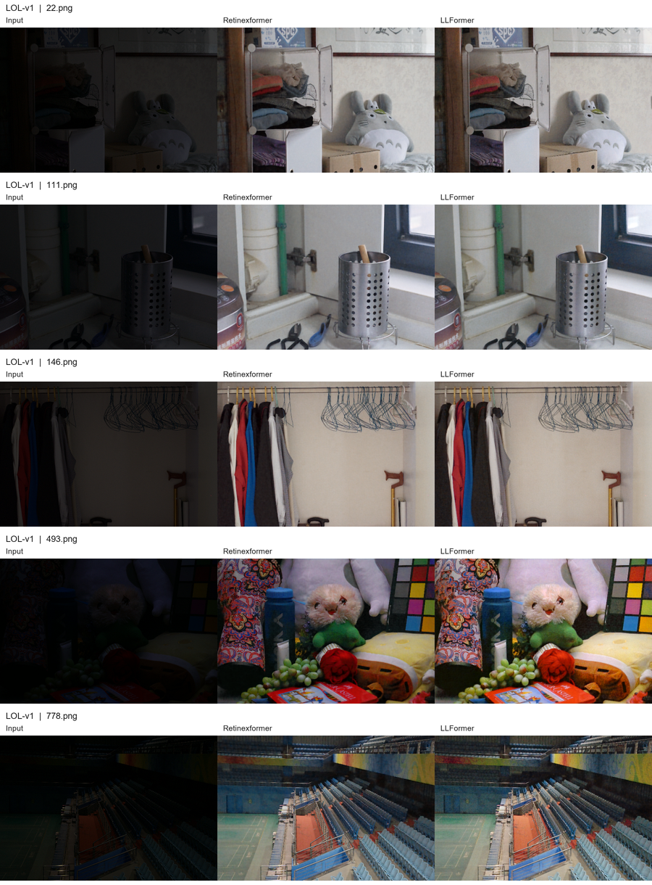
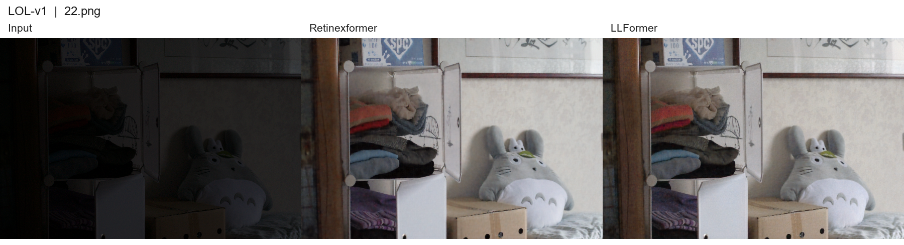
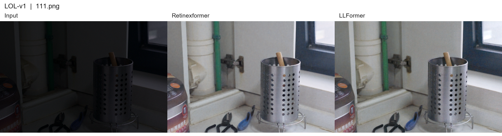
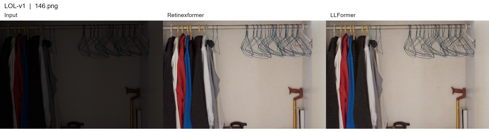
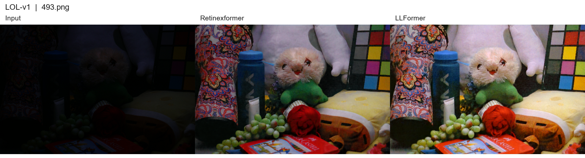
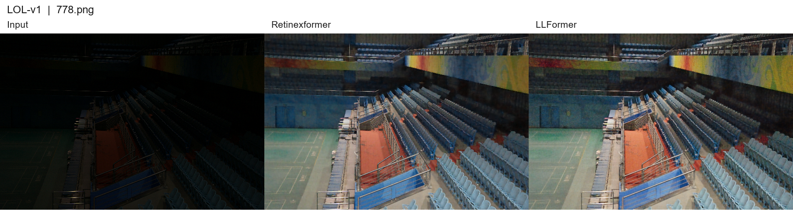

# M2 五图视觉展示报告

状态：**PASS**。执行日期：2026-11-23。原图/Retinexformer/LLFormer三列对照，输入5张、增强输出10张，均为600×400 RGB。

## 样本与运行设置

使用固定Retinexformer官方demo附带的全部五张LOL-v1测试图，按22、111、146、493、778顺序登记。清单及SHA-256在 `configs/m2_samples.json`；没有按增强结果挑选图片。输入来源为LOL数据集作者页面与官方 `demo/examples/README.md`，用于非商业学术研究与方法效果展示，保留图像来源署名。

官方源码：Retinexformer `2dd9ae05f34a34e2df3b955f743215ac3cda0f82`；LLFormer `ed5e7bf61d2dc64ba3b4552b90eb68a38f6c5302`。

官方权重沿用M1：Retinexformer LOL_v1.pth（SHA-256 `9b4810dc51322fab70be8658ee0ad1df64a54aa814497b7849767baa2ff32cd1`）；LLFormer LOL model_bestPSNR.pth（`2ff4907e4c277194adaa3ff302a01eb04d54ac9908afe70acbcfed2029d81551`）。

设备为Windows CPU；Python3.7.9、Torch1.13.1+cpu、torchvision0.14.1+cpu；两个原M1环境独立复用。每次CPU使用4线程、float32、eval模式，输入保持原尺寸，Gamma=1、亮度=1，无自集成或GT_mean。Retinexformer的4倍数padding和LLFormer的16倍数padding/裁回沿用M1。没有进行训练或修改网络。

运行入口是 `scripts/run_m2.ps1` / `scripts/run_m2.py`。原始本机参数保留在忽略的run目录；提交的run_record中个人路径替换为占位符。实际推理代码提交为 `ead81b3688bc6c505b48a8af9b7545513a5b3255`，记录同时保存三个推理脚本SHA-256及样本清单SHA。

## 总览



总览按相同比例缩至900像素宽供网页展示；逐图面板中三个图像区均为原生600×400，像素原样拼接，未单独调亮、锐化或美化。十张独立增强PNG保存在 results/m2/ 对应模型目录。

## 逐图观察

### 22.png：收纳柜与灰色玩偶



- 亮度：两模型均提亮柜内布料和玩偶，墙面与柜门从暗区显现。
- 暗部纹理：布料折叠、纸箱孔洞与玩偶五官可辨。
- 噪声/颗粒：浅墙、柜门与暗色布料仍可见颗粒。
- 颜色：红蓝布料、木框和灰色玩偶的颜色区分清楚。
- 高亮区域：白柜门与墙面较亮，柜门边界和玩偶轮廓仍清楚。
- 边缘：柜门直线、纸箱边角保持连续。

### 111.png：窗边金属筒与管道



- 亮度：Retinexformer台面观感略亮；LLFormer筒身阴影更深。
- 暗部纹理：筒身孔洞、金属反光、管道与工具细节显现。
- 噪声/颗粒：背景灰墙和金属表面可见细颗粒。
- 颜色：绿色管道和蓝色工具可辨，金属筒呈灰色。
- 高亮区域：窗边高亮区域较亮，筒身仍有明暗渐变。
- 边缘：筒口、孔洞和窗框边界可辨。

### 146.png：衣物、衣架与浅色墙



- 亮度：衣物和衣架区域被整体提亮，墙面亮度更均匀可见。
- 暗部纹理：深色外套、条纹衣物与密集细衣架线可辨。
- 噪声/颗粒：平坦墙面仍存在细颗粒。
- 颜色：红色、蓝色和灰色衣物能区分，背景明暗分配略有差异。
- 高亮区域：浅墙保持连续色调，未出现大块纯白区域。
- 边缘：衣架细线和挂杆边缘连续。

### 493.png：彩色静物、玩偶与色卡



- 亮度：LLFormer的玩偶脸部和黄色靠垫更亮；Retinexformer整体观感较暗。
- 暗部纹理：花纹布、葡萄、瓶身与玩偶轮廓显现，细绒毛呈颗粒状。
- 噪声/颗粒：绒毛、布纹和阴影区域仍有颗粒。
- 颜色：LLFormer红色花朵和黄色区域更鲜艳；Retinexformer色彩较收敛。
- 高亮区域：LLFormer浅色玩偶和靠垫的高亮更强。
- 边缘：色卡边界、花朵和水果轮廓可辨。

### 778.png：体育馆看台与通道



- 亮度：两模型均显露原先较暗的看台、场地和通道。
- 暗部纹理：座椅排列、场地边线、栏杆与台阶结构可辨。
- 噪声/颗粒：暗墙和看台表面仍有明显的颗粒与斑驳色彩。
- 颜色：蓝色看台、橙色通道和绿色场地的色彩分区清楚。
- 高亮区域：前排浅色座椅较亮，单椅间隔仍可区分。
- 边缘：栏杆和密集座椅边缘可辨，场地边线连续。

## 验收与解释

- 五张输入在两模型运行前均核对SHA-256；两个模型读取同一份运行输入。
- Retinexformer每张严格加载122个参数张量；LLFormer严格加载1485个参数张量，日志为1/5至5/5，处理相同五张图。
- 10张输出通过解码、RGB模式、600×400尺寸、uint8范围、非恒定与非输入复制检查；111.png两模型输出与M1历史图逐字节一致。
- M2完成的是五图定性展示。PSNR/SSIM、配对GT评估与统一计时属于下一阶段M3。本轮日志中的耗时保留为执行记录，不做模型速度排名。
- 颗粒、色彩与高亮描述来自这批实际图像的视觉检查，没有GT辅助判断。没有执行M4分块或融合优化。

## 重跑与文件

```powershell
./scripts/run_m2.ps1 -OutputDir runs/m2/reproduce
& ./.venvs/retinexformer/Scripts/python.exe scripts/validate_m2.py --run runs/m2/reproduce --output runs/m2/reproduce/validation.json
& ./.venvs/retinexformer/Scripts/python.exe scripts/render_m2.py --run runs/m2/reproduce --output runs/m2/reproduce/figures
```

`configs/m2_samples.json` 保存来源/哈希/预处理，`results/m2/run_record.json` 保存实际运行配置、代码SHA和命令，`results/m2/validation.json` 保存十图完整性检查，`logs/m2/` 保存脱敏严格加载/推理日志，`experiments/m2_visual/observations.csv` 与JSON保存六维逐图观察。
