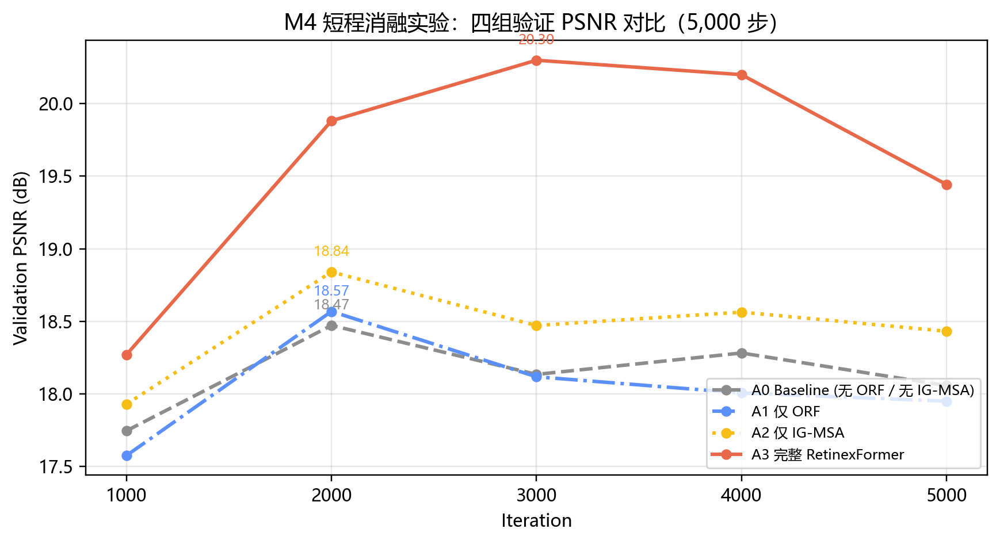
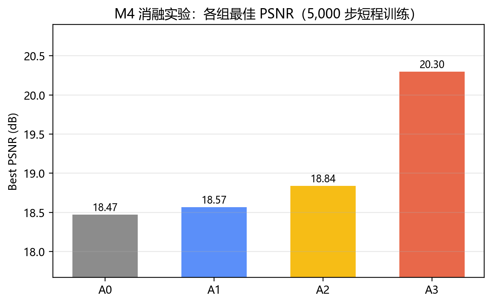

# m4_retinexformer_ablation

RetinexFormer 光照引导模块（ORF / IG-MSA）的**短程消融实验**。

本目录与 `experiments/m4_tiling/`（LLFormer 分块推理与融合）互补，是两个不同的研究对象：
前者针对 RetinexFormer 的网络模块，后者针对 LLFormer 的大图分块管线。二者不混报。

## 训练条件

| 项目 | 内容 |
| --- | --- |
| 模型 | RetinexFormer（`n_feat=40, stage=1, num_blocks=[1,2,2]`），结构不变 |
| 权重初始化 | 从零训练，不使用官方预训练权重 |
| 数据集 | LOL-v1，训练 485 张 / 验证 15 张 |
| 训练步数 | 5,000（四组完全一致） |
| 随机种子 | `manual_seed: 100` |
| 设备 | RTX 3050 Laptop 4GB，CUDA 11.3 |
| 环境 | Windows；Python 3.10.22；PyTorch 1.11.0；TorchVision 0.12.0；BasicSR 1.2.0+cc63400 |
| 实际生效 batch / patch | 8 / 128×128（训练启动后由 BasicSR 自动调整，日志有记录） |
| 验证频率 | 每 1,000 步，PSNR `crop_border=0, test_y_channel=False` |

四组唯一变量是 ORF 与 IG-MSA 是否启用，其余全部固定。

## 结果

| 实验 | ORF | IG-MSA | 含义 | 最佳 PSNR | 最佳迭代 | 后 3 次平均 PSNR | 耗时 |
| --- | --- | --- | --- | --- | --- | --- | --- |
| A0 | ✗ | ✗ | Baseline（两模块均移除） | 18.4716 | 2,000 | 18.1574 | 4.4 分钟 |
| A1 | ✓ | ✗ | 仅 ORF | 18.5679 | 2,000 | 18.0242 | 7.8 分钟 |
| A2 | ✗ | ✓ | 仅 IG-MSA | 18.8396 | 2,000 | 18.4884 | 4.8 分钟 |
| A3 | ✓ | ✓ | 完整 RetinexFormer | 20.2992 | 3,000 | 19.9808 | 8.0 分钟 |





### 关键差值

| 对比 | 差值 |
| --- | --- |
| A3 − A0（两模块合计） | +1.8276 dB |
| A2 − A0（IG-MSA 单独） | +0.3680 dB |
| A1 − A0（ORF 单独） | +0.0963 dB |
| A3 − A1（去掉 IG-MSA） | +1.7313 dB |
| A3 − A2（去掉 ORF） | +1.4596 dB |

### 结论（仅限本机 5,000 步数据）

- 完整模型比 Baseline 高 **1.83 dB**，两个模块都有正贡献。
- 单独使用时 IG-MSA（+0.37 dB）优于 ORF（+0.10 dB）。
- 单模块贡献之和仅 +0.46 dB，同时启用却达 +1.83 dB，提示二者存在**协同作用**：
  IG-MSA 以光照特征作为注意力引导，缺少 ORF 时引导信息退化。
- 趋势：**A3 ≫ A2 > A1 > A0**。
- 5,000 步为短程训练，A3 的 20.30 dB 显著低于官方权重的 25.16 dB，**不宣称复现论文性能**。

## 消融实现

在 `basicsr/models/archs/RetinexFormer_arch.py` 上加入两个全局开关
（完整模型等价于 `ABL_IGMSA=1, ABL_ESTIMATOR=1`）：

```python
# 文件顶部
ABL_IGMSA = 1
ABL_ESTIMATOR = 1

# IGAB.forward
if ABL_IGMSA == 1:
    x = attn(x, illu_fea_trans=illu_fea.permute(0, 2, 3, 1)) + x
x = ff(x) + x

# RetinexFormer_Single_Stage.forward
if ABL_ESTIMATOR == 1:
    illu_fea, illu_map = self.estimator(img)
    input_img = img * illu_map + img
    output_img = self.denoiser(input_img, illu_fea)
else:
    illu_fea = img.new_zeros((img.shape[0], self.estimator.n_fea_middle,
                              img.shape[2], img.shape[3]))
    output_img = self.denoiser(img, illu_fea)
```

启用前用 `code/test_ablation_smoke.py` 对四组各做 64×64 前向验证：
输出形状正确、数值有限、无 NaN，冒烟测试 PASS。

## 复现

```powershell
conda activate Retinexformer

# 四组配置前向可用性
python experiments/m4_retinexformer_ablation/code/test_ablation_smoke.py

# 依次跑 A0/A1/A2（A3 为完整模型，需先单独训练 5,000 步作为基准）
python experiments/m4_retinexformer_ablation/code/run_ablation.py

# 生成图表
python experiments/m4_retinexformer_ablation/code/m4_plot.py
```

`run_ablation.py` 会改写 `RetinexFormer_arch.py` 的两行开关，并在每组结束后把 `experiments/`
归档到 `runs_ablation/<组名>/`。原始文件请先自行备份。

## 局限

- 每组仅 1 次运行，无重复与方差统计；0.10 dB 级别的差值（A1−A0）不宜作强结论。
- 训练启动后 BasicSR 把 patch 64→128、batch 2→8，与仓库记录的配置不同；但四组一致，组间比较有效。
- 未记录峰值显存，只确认全程无 OOM、无 NaN。
- 未做多次种子重复，也未扩到更长训练步数。

## 目录

```text
experiments/m4_retinexformer_ablation/
├── README.md
├── code/
│   ├── run_ablation.py           四组消融自动执行（改写开关 → 训练 → 归档 → 汇总）
│   ├── m4_plot.py                生成 PSNR 曲线与最佳 PSNR 柱状图
│   └── test_ablation_smoke.py    四组配置前向冒烟测试
├── data/
│   ├── summary.csv               四组汇总指标
│   ├── psnr_curves.json          逐组验证 PSNR 原始点
│   └── A0~A3_*.log               四组完整训练日志（已脱敏）
└── figures/
    ├── m4_ablation_psnr_curves.png
    └── m4_ablation_best_psnr.png
```

权重与完整实验目录体积较大，未提交。
