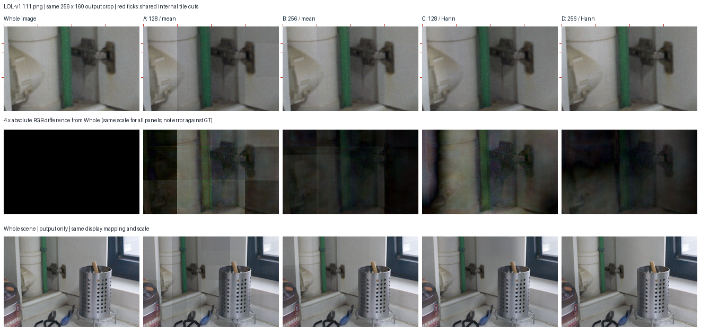

# LLFormer 实测：分块网格与融合

固定官方 LOL 权重、CPU 四线程和全部 15 对 eval15。先在训练划分的 2.png 扫描九种网格，再按已冻结的四组设置报告正式结果。全图结果来自同机 M3；未使用测试集选参数。

|组别|块 / 步长|融合|PSNR dB ↑|SSIM ↑|边界带 MAE ↓|内部 MAE ↓|跨线梯度误差 ↓|
|---|---|---|---:|---:|---:|---:|---:|
|full|整图|无|23.6486|0.81846|16.087|16.197|4.755|
|A|128 / 64|均值|21.8421|0.80287|19.562|19.333|7.220|
|B|256 / 128|均值|23.3641|0.81671|16.600|16.598|5.297|
|C|128 / 64|Hann|21.5599|0.80785|19.945|19.728|4.755|
|D|256 / 128|Hann|23.3059|0.81775|16.550|16.659|4.748|

所有组使用两个网格的内部起止线并集，边界带取每条线两侧各 2 像素。MAE 单位为 8-bit 通道灰阶；跨线梯度误差为预测与 GT 在跨线相邻像素对上的一阶差之差的绝对值。边界带 MAE 也受整体亮度影响，不能单独证明消除了可见接缝。

|配对变化（前组减后组）|平均 ΔPSNR|PSNR 改善图数|平均 ΔSSIM|SSIM 改善图数|平均 Δ边界 MAE|
|---|---:|---:|---:|---:|---:|
|C-A|-0.2821|0/15|+0.00498|15/15|+0.383|
|D-B|-0.0582|3/15|+0.00103|12/15|-0.050|
|B-A|+1.5220|14/15|+0.01384|13/15|-2.961|
|D-C|+1.7460|14/15|+0.00989|10/15|-3.395|
|D-A|+1.4639|14/15|+0.01487|13/15|-3.012|
|D-full|-0.3426|4/15|-0.00071|8/15|见上表|

固定网格时 C−A 和 D−B 隔离融合影响；固定融合时 B−A 和 D−C 隔离块大小影响。平均方向与逐图方向可能不同：

- C-A 的逐图 PSNR 差范围 [-0.754, -0.026] dB，最低差出现在 669.png。
- D-B 的逐图 PSNR 差范围 [-0.194, +0.049] dB，最低差出现在 547.png。
- D-A 的逐图 PSNR 差范围 [-1.468, +6.021] dB，最低差出现在 493.png。

## 资源

固定 111.png，Apple M5 CPU 四线程。各组独立进程、一次预热、五次测量；秒数为中位数 [最小, 最大]。纯网络时间是各块前向之和；分块管线含提块、融合及裁回；端到端另含读图和写 PNG。RSS 为进程生命周期峰值，不能作单块张量内存解释。

|组别|纯网络 s|分块管线 s|端到端 s|峰值 RSS GiB|
|---|---:|---:|---:|---:|
|A|35.99 [31.75, 49.14]|36.00 [31.76, 49.15]|36.03 [31.79, 49.18]|0.67|
|B|34.32 [33.67, 35.25]|34.33 [33.67, 35.25]|34.36 [33.71, 35.29]|0.88|
|C|27.75 [21.18, 40.10]|27.76 [21.18, 40.11]|27.78 [21.20, 40.13]|0.69|
|D|41.80 [24.18, 44.23]|41.81 [24.19, 44.24]|41.84 [24.21, 44.29]|0.91|

## 边界与复核

具体图（包括退化样本）见每组 metrics.csv；固定 111.png 全图和 1:1 局部图由 inspect_llformer_edges.py 生成到本地，不向仓库复制输入或 GT。开发扫描只有一张训练图，不能从它推断全测试集的最优重叠率。

原版 B0 和仅改设备后执行的结果见 ../b0/ 及 b0-real/results.json；B0 失败不纳入均值或给作 0 分。分辨率扩展和停止原因见 scale/resolution.json。LOL 图放大仅用于测资源，不是 UHD 数据集、UHD 权重或论文 4K 结果。

作者自检：对 60 张正式输出和 9 张开发输出从保存的 PNG 独立复算 PSNR/SSIM 和边界掩膜；核实 24 次定点计时输出与对应正式图一致。无人类第二复核人，不代签；本机无 CUDA。

固定样本的墙面、管道在 A 组可见矩形亮度台阶；C 组相同位置的过渡更连续，但与整图仍有低频亮度偏差。差图以整图为参照，不是 GT 误差。全 15 张中，128 块改 Hann 后，跨线梯度误差均有下降（均值 7.220→4.755），SSIM 全部提高，PSNR 却全部下降。这说明局部连续性提升并不保证整图像素值更准确。256 块均值给出最高的分块平均 PSNR，256 块 Hann 给出最高的分块平均 SSIM；本次两项平均值均未超越整图。

在本机的固定样本上，整图端到端中位数 12.34 s，峰值进程 RSS 2.77 GiB；四组分块均占用更少的峰值内存，但均慢于整图。不同组测量分时进行，CPU 状态未锁定，不能由 A/C 的次序断言 Hann 本身加速。开发图扩展实测长边 512 用时 22.31 s、1024 用时 110.90 s。2048 预计约 475 s/图，超过预先约定的 180 s/图门槛，没有运行；未报告 4K/8K 画质。现有作业不需要租卡。

生成共享图：`python scripts/panel_llformer_m4.py runs/m4-study runs/m3-eval15-01 runs/comparison.png`。原始数据出处和许可见仓库 data/README.md 与 THIRD_PARTY_NOTICES.md。
